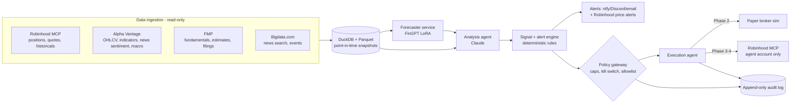

# Agentic Investment Advisor: Design and Phased Plan

Status: **DRAFT for review. No code yet.**
Owner: git-commit-duke. Last updated: 2026-11-25.

Goal: an agent that analyzes the Robinhood portfolio, forecasts, raises signal alerts from price/chart, news, macro and fundamentals data, and later trades a **separate, small agent account** under hard caps.

---

## 0. Honest framing (read first)

- **LLM weekly forecasts are unproven alpha.** FinGPT-Forecaster was trained on Dow-30 news and prices from 2023-05 to 2024-05. The paper reports direction-hit rates, not risk-adjusted returns after costs. Nobody has shown it beats buy-and-hold out of sample.
- **The gate is evidence, not vibes.** Every phase advances only when its exit criteria pass on data the model never saw. If the forecaster loses to "always up" or a 12-week momentum rule, it stays an analysis aid and never drives trades.
- **Most of the value is in Phase 1.** A disciplined daily brief, earnings/catalyst calendar and risk alerts on your real holdings is useful even if no model ever earns the right to trade.

---

## 1. Architecture



### 1.1 Data ingestion
- **Problem:** backtests lie when they use data that wasn't available at decision time (lookahead bias). **Idea:** store every fetch with an `as_of` timestamp and only read rows with `as_of <= decision_time`. **Tool:** DuckDB over Parquet, partitioned by date. It's boring, it's one file, and it needs no server.
- Sources, by job:
  - Prices/OHLCV, indicators: Alpha Vantage (`TIME_SERIES_DAILY_ADJUSTED`, `RSI`, `MACD`), with Robinhood `get_equity_historicals` as a cross-check.
  - News: Alpha Vantage `NEWS_SENTIMENT`, Bigdata.com search, FMP news. **The Forecaster's prompt expects Finnhub news and profiles.** Map these sources into that prompt shape so you don't need a 6th API key.
  - Fundamentals/estimates: FMP statements, analyst estimates, Robinhood `get_equity_fundamentals`.
  - Macro: Alpha Vantage `CPI`, `FEDERAL_FUNDS_RATE`, `TREASURY_YIELD`, `UNEMPLOYMENT`.
  - Portfolio: Robinhood `get_portfolio`, `get_equity_positions`, `get_equity_tax_lots`.
- Runs on a schedule (systemd timer or cron in a container). Pre-market, close, and weekly (the Forecaster is weekly).

### 1.2 Forecaster service
Weights: base `meta-llama/Llama-2-7b-chat-hf` (gated, needs a license-accepted HF token) + LoRA `FinGPT/fingpt-forecaster_dow30_llama2-7b_lora`. The code already exists in `fingpt/FinGPT_Forecaster/app.py`. The plan is to wrap it as a small HTTP service (`POST /forecast {ticker, date}` returning `{direction, magnitude_bucket, rationale}`), not as a Gradio app.

| Option | How | Cost (estimates, **not verified**; check current pricing) | Verdict |
|---|---|---|---|
| A. HF Inference Endpoint | Deploy a merged base+LoRA model on a 24 GB GPU (A10G/L4), scale-to-zero | About $0.8 to $1.3 per GPU-hour. Weekly batch of 50 tickers is about 10 min, so a few $/month plus cold starts | **Recommended start.** No hardware, pay per use |
| B. Local / homelab GPU | `transformers` + `peft`, 4-bit via bitsandbytes (about 6 GB VRAM) or fp16 (about 14 GB) | Electricity only, if you own the GPU | Best long term if you have a 12 GB+ card |
| C. CPU only (llama.cpp GGUF, merged + quantized) | Merge LoRA, convert to GGUF Q4 | Free, slow (about 30 to 90 s per forecast, guess) | Fine for a weekly batch; good learning rep |
| D. Serverless HF Inference API | Doesn't reliably serve custom LoRA on gated bases (not verified) | Free tier | Don't plan on it |

Known limits: trained on Dow-30 only. Llama-2 base knowledge stops in 2023. Out-of-sample evaluation **must use weeks after 2024-05**, or the backtest is contaminated by training data.

### 1.3 Analysis agent (Claude)
- Inputs: portfolio snapshot, point-in-time data, forecaster output as **one feature among many**.
- Output: a structured JSON brief (per-ticker thesis, risks, catalysts, forecaster agreement or disagreement, confidence), rendered to markdown.
- Rule: the analysis agent **cannot call any order tool**. It writes recommendations to the store. That's all.

### 1.4 Signal and alert engine
- **Problem:** LLM output is non-deterministic and hard to test. **Idea:** turn the LLM's opinion into features, then let plain, unit-tested rules decide signals. **Tool:** a Python rules module with pytest. Rules look like `if forecast=up AND RSI<70 AND no earnings in 5d AND position_weight<cap -> BUY_CANDIDATE`.
- Alerts: drawdown beyond threshold, concentration over N%, earnings within 3 days, big gaps, forecaster flips. Delivery goes through ntfy/Discord webhook, plus Robinhood `create_alert` for price levels (non-trading, allowed from Phase 1).

### 1.5 Execution agent and policy gateway
- **Problem:** a prompt-injected news article or a buggy loop could tell an agent to "sell everything". **Idea:** the agent never talks to the broker directly. A deterministic gateway sits between them and enforces limits that no prompt can change. **Tool:** a small MCP proxy (or Python service) that exposes only `propose_order`. It checks the policy, logs, and only then forwards to Robinhood `review_equity_order` / `place_equity_order` for the **agent account number only**.
- The paper broker (Phase 2) implements the same interface, so the swap is config, not code.

### 1.6 Where it lives in the repo
New top-level `advisor/` package. `finogrid/` is a payout platform, and coupling the two adds risk to both. Reuse `finogrid` patterns (structlog, agent layout, MCP server skeletons). **Open question for you.**

---

## 2. Phases and exit criteria

| Phase | Scope | Order tools | Exit criteria (all must pass) |
|---|---|---|---|
| **0. Foundation** | Repo hygiene from the security/CI thread: secrets out, CI, SAST/SCA, SBOM. `advisor/` skeleton | Denied | CI green with gitleaks + bandit/semgrep + pip-audit + SBOM. No secrets in history scan. Separate security thread's baseline merged |
| **1. Read-only analysis + alerts** | Ingestion, store, daily/weekly brief, alert engine, forecaster via option A or C | Denied | 20 trading days of briefs with no missed runs. Alerts fire in tests for each rule. Every brief reproducible from stored `as_of` data. You rate the briefs useful, or we cut scope |
| **2. Paper trading + backtest** | Walk-forward backtest (weeks after 2024-05 only), paper broker sim, nightly P&L | Denied (paper sim only) | ≥ 200 out-of-sample weekly forecasts. Direction hit-rate beats the "always up" base rate with binomial p < 0.05. Strategy beats SPY buy-and-hold **after** costs/slippage on Sharpe **and** max drawdown over the walk-forward window. 8 weeks of live paper results inside the backtest's expected range. **If it fails, stop here: the advisor stays analysis-only** |
| **3. Human-approved trades** | Real orders on the agent account, each one approved by you | `review_equity_order` allowed. `place_equity_order` only via gateway, only after your explicit approval | Robinhood trade-approval setting ON and verified via `get_trade_approval_setting`. 20 approved trades with zero guardrail violations. Audit log reconciles 100% with `get_equity_orders`. Kill switch drill done |
| **4. Capped autonomous** | Gateway places trades within caps, no per-trade approval | `place_equity_order` via gateway only | 3 months in phase 3 with live P&L tracking paper. Caps never breached. Monthly review of the audit log. You sign off in writing (PR approving the phase-4 config) |

Equities only, long-only, market hours, limit orders. Options, crypto, margin and shorting stay out of scope until a separate review.

---

## 3. Hard guardrails (trading)

Enforced in the **gateway** (code), not in prompts.

1. **Separate agent account.** A dedicated Robinhood account, funded with an amount you can lose entirely (suggest ≤ $500 to start). The gateway hard-codes that account number. Any order for another account is rejected.
2. **Robinhood trade-approval setting ON** through phase 3. Check it with `get_trade_approval_setting` at gateway startup. Refuse to start if it's off.
3. **Per-trade cap:** max notional per order (for example $50 or 10% of agent equity, whichever is lower).
4. **Daily loss cap:** if realized + unrealized P&L for the day ≤ −X% (for example −3%), block new buys for the rest of the day and alert.
5. **Exposure caps:** max position weight (for example 20%), max open positions, max orders per day (for example 5), allowlisted tickers only.
6. **Kill switch:** a file or flag (`KILL=1`) checked before every order, plus a one-command "deny all" (below). Tripped automatically by a cap breach, an error spike, or data staleness over 1 day.
7. **Audit log:** append-only JSONL plus a hash chain (each line includes the hash of the previous one). It records the proposal, inputs, policy decision, the order request/response and your approval. It's shipped off-box daily. **Problem:** logs on the same box as the agent can be edited. **Idea:** hash chaining makes tampering detectable. **Tool:** `sha256` over the previous line.
8. **Deny `place_*` until the gated phase.** In Claude Code settings, deny these at the harness level, so they're blocked no matter what any prompt says:

```json
{
  "permissions": {
    "deny": [
      "mcp__robinhood_mcp__place_equity_order",
      "mcp__robinhood_mcp__place_option_order",
      "mcp__robinhood_mcp__place_crypto_order",
      "mcp__robinhood_mcp__place_advanced_order",
      "mcp__robinhood_mcp__cancel_equity_order",
      "mcp__robinhood_mcp__cancel_option_order",
      "mcp__robinhood_mcp__cancel_crypto_order",
      "mcp__robinhood_mcp__cancel_advanced_order",
      "mcp__robinhood_mcp__exercise_option",
      "mcp__robinhood_mcp__decline_trade_approval"
    ]
  }
}
```
Undo: remove the entries. That is deliberately a reviewed PR, never an agent action.

---

## 4. Security

- **Secrets:** none in code, notebooks or chat. Locally: `.env` (gitignored) loaded with `pydantic-settings`. Deployed: a secret store (GitHub Actions secrets, or `sops` + age for homelab). Rotate the W&B/HF keys already in `fingpt/` history. That work belongs to the security thread.
- **Least privilege per component:**

| Component | Gets | Never gets |
|---|---|---|
| Ingestion | Read-only data API keys, Robinhood read tools | Any order tool |
| Forecaster | HF token scoped **read** (fine-grained, gated-model read only). No network egress beyond HF | Broker access |
| Analysis agent | Store read, write `recommendations` table | Order tools, secrets |
| Gateway | Robinhood order tools for **agent account only** | Personal account, outbound except Robinhood + alert webhook |

- **Prompt injection:** news text is untrusted input. It goes to the LLM as quoted data. The LLM's output only becomes features, and the deterministic rules plus the gateway decide. No tool calls are triggered by content.
- **Containers:** non-root, read-only rootfs, pinned image digests. CI: SHA-pinned actions, gitleaks, semgrep/bandit, pip-audit, Trivy, SBOM (syft).
- **Dependency risk:** `fingpt/` is vendored upstream with heavy deps. `advisor/` must not import from it. Copy the ~100 lines of prompt-building code with attribution (MIT license).

---

## 5. Open questions for you

1. GPU: do you have a homelab GPU (≥ 12 GB), or start with an HF Inference Endpoint?
2. Package location: top-level `advisor/` (recommended) or under `finogrid/`?
3. Alert channel: ntfy, Discord, or email?
4. Agent account funding cap for phase 3 (suggest ≤ $500)?
5. Universe: your current holdings only, or holdings + a Dow-30 watchlist (where the Forecaster was trained)?

## 6. Proposed first code tasks (after your OK)
1. `advisor/` skeleton + CI (coordinate with the security thread).
2. Ingestion into DuckDB with `as_of` snapshots, for your holdings.
3. Forecaster wrapper (option C CPU or A endpoint), batch over holdings, stored outputs.
4. Daily brief + 3 alert rules with tests.
